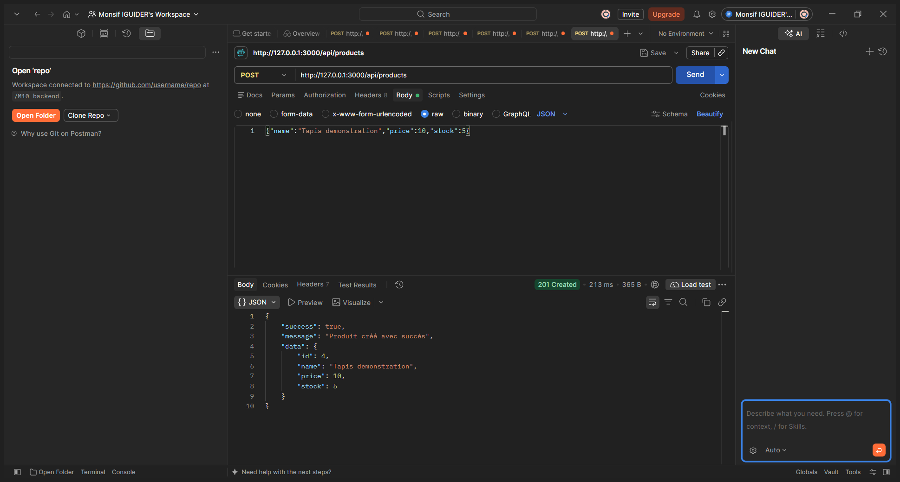
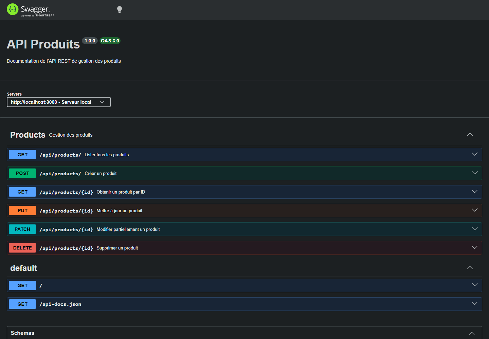
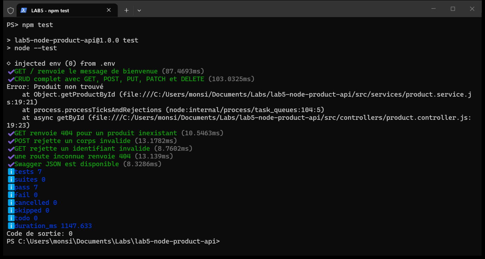

# Rapport de réalisation — LAB5

## API REST de produits avec Node.js et Express

**Étudiant(e) :** ____________________

**Date de remise :** ____________________
**Projet :** [lab5-node-product-api](https://github.com/IguidMnsf/backend-labs/tree/main/lab5-node-product-api)

## 1. Objectif

Ce laboratoire consiste à construire une API REST de gestion de produits en Node.js et Express. Il met en pratique le routage, la structuration en couches, la validation des entrées, la gestion d'erreurs et la documentation OpenAPI.

## 2. Réalisation

Les routes acheminent les requêtes vers les contrôleurs, les services appliquent les règles métier et le repository gère les produits. Les données entrantes sont validées avec `express-validator`. Un middleware centralise les réponses d'erreur.

L'API expose les opérations CRUD : lecture, création, remplacement complet (`PUT`), modification partielle (`PATCH`) et suppression. Swagger UI fournit une documentation interactive à `/api-docs`.

Les données sont gardées dans un tableau en mémoire et reviennent aux valeurs initiales au redémarrage. Le document OpenAPI est livré dans le projet ; sa régénération est une commande explicite (`npm run swagger`).

## 3. Vérifications

La commande `npm test` a réussi : **7 tests passés, 0 échec**. Ils vérifient la route d'accueil, le cycle CRUD, la validation, les identifiants invalides, les erreurs `404` et la disponibilité de la documentation Swagger.

Lors d'un essai local, `GET /api/products` a renvoyé le statut HTTP `200`. La collection Postman contient les requêtes de démonstration et la documentation est accessible lorsque le serveur est démarré.

## 4. Conclusion

Le projet fournit une API modulaire, testée et documentée avec Express. Le stockage en mémoire répond aux besoins du laboratoire, mais ne conserve pas les changements après l'arrêt de l'application.

## 5. Captures des exécutions

**Création d'un produit dans Postman — HTTP 201 :**

**Documentation Swagger de l'API locale :**

**Tests automatisés — `npm test` :**

